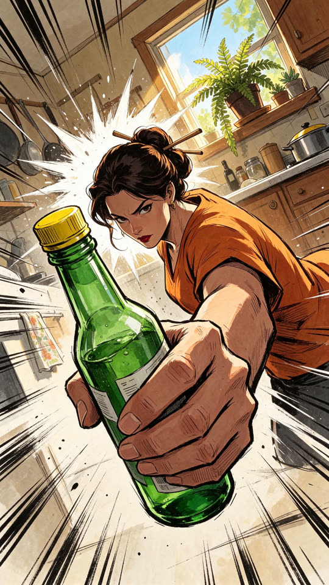

# Action Manga (Anime and manga)
<!-- generated from studio/styles/catalog/action-manga.json by studio/bin/catalog.mjs; edit the JSON -->

**Looks like:** extreme foreshortening, with hands and feet thrust at the lens; speed lines, impact bursts and motion streaks; dramatic low and high angles with tilted horizons; heavy inks with sharp hatching and high-contrast light.
**Best for:** high-energy hooks, a product shown as the decisive move, sports, gaming and energy brands, exaggerated everyday battles (a stain, a deadline, a wilting plant). **Products:** energy drinks, sports gear, cleaning products, gadgets, games, anything with a 'power move'; bold, competitive, funny-epic brands.

## STYLE block (paste verbatim into every shot prompt and every sheet prompt)
Dynamic action manga brought to life in colour: bold heavy ink lines with sharp pressure tapers and aggressive hatching on shadow sides; extreme foreshortening, with hands and objects thrust toward the lens at exaggerated scale; dramatic low and high angles with tilted horizons; speed lines, radial focus lines and motion streaks drawn as inked strokes behind moving forms; cel colour with hard, high-contrast shadow shapes, rim light from behind, and impact flashes drawn as white starbursts; backgrounds dissolve into speed lines during action; it looks hand-inked and energetic, never 3D.

## Rendering
- Line: heavy, sharp ink line with fierce tapers; dense hatching and cross-hatching on shadow sides
- Shading: hard two-tone cel shadows, strong rim light, occasional dot screentone in the darks
- Colour: saturated, high-contrast colour with deep shadows; backgrounds can drop to a single flat hue behind speed lines; product colours exact
- Texture: inked speed lines and hatching strokes, debris flecks, dust and impact bursts drawn by hand
- Lighting: dramatic backlight and rim light, flashes of white on impact, strong directional key

## MOTION block
Explosive pose-to-pose motion on twos and threes: a held wind-up, then a one- or two-frame smear into a held impact pose; camera shake on impacts; speed lines streaming behind the move; a freeze on the key pose with a short slow push; debris and hair whipping with the motion.

## CAMERA habits
Wide lens close to the subject for foreshortening, low-angle heroic frames, a fast whip pan or crash zoom into the impact, Dutch tilts; a brief shake on hits; holds on the strongest pose.

## Avoid (name these instances only when the shot is at risk)
- calm eye-level staging with level horizons
- smooth 3D-rendered motion blur instead of drawn speed lines
- soft pastel shading
- sound-effect lettering and katakana-like scribbles
- hands and the product melting into smears during the move

## Element sheets for consistency
Each character sheet shows front, three-quarter and side plus two foreshortened action poses (a reaching hand toward the camera, a low-angle stance) in the exact line weight and colours; the product is drawn at normal scale and in a foreshortened close view with its exact silhouette and colours.

## Where Seedance goes wrong in this style
Fast action is where Seedance breaks: hands, faces and the product smear or change shape mid-move, and it renders blur instead of drawn speed lines. Put the product in a held pose at the start and end of the move, keep the smear to under a quarter second, and say 'drawn ink speed lines, no motion blur'. Sound-effect lettering appears unbidden; forbid it in NO TEXT.

## Models
Sheets and places: `bytedance-seed/seedream-5-5` · video: `bytedance/seedance-2.5` (draft on Flash 480p, final on 2.5 720p with the same prompt, references and seed).

## Example still (our own generation)
Prompt: Action manga still in colour: a woman in her thirties with a dark bun and an orange top thrusts a small green glass bottle with a yellow cap toward the lens in extreme foreshortening, her hand and the bottle huge in the foreground, low dramatic angle with a tilted horizon; a sunny kitchen behind her breaking into radial inked speed lines, a droopy fern on the windowsill caught in rim light; heavy tapered ink lines, sharp hatching, hard cel shadows, a white impact burst behind the cap. Vertical 9:16. No text.

## Sources (look, don't copy)
- [Kling AI · Cartoon Styles for AI (Action Manga Style)](https://kling.ai/blog/cartoon-styles-for-ai)
