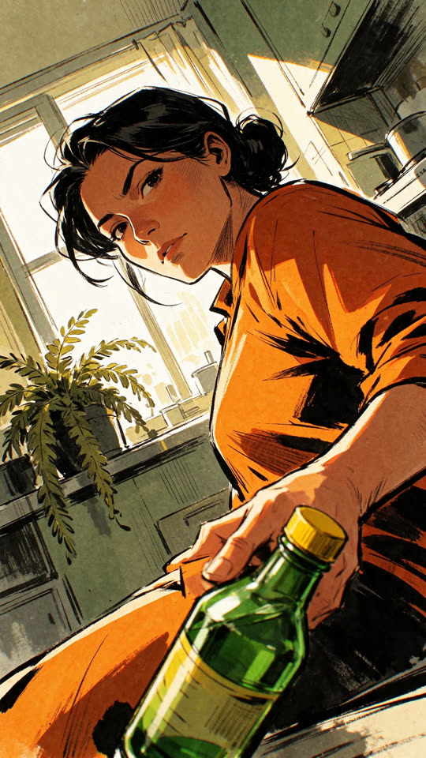

# Comic Book (Comic and graphic art)
<!-- generated from studio/styles/catalog/comic-book.json by studio/bin/catalog.mjs; edit the JSON -->

**Looks like:** heavy tapered black ink with spot blacks; hard chiaroscuro from one strong light; dramatic foreshortened poses and tilted framing; flat colour with a single shadow tone and slight print texture.
**Best for:** high-stakes everyday drama played as heroics, action beats and big reveals, serial ads with a cliffhanger. **Products:** products with a bold silhouette and strong colour (drinks, tools, sports, tech); confident, energetic brands.

## STYLE block (paste verbatim into every shot prompt and every sheet prompt)
Comic-book art in motion: bold black brush-and-nib ink outlines with tapered weight, thick on the shadow side and thin on the lit side; hard-edged spot blacks carve the forms, with feathered hatching in the half-tones; flat colour fills in a limited saturated palette with one hard cel shadow tone; a faint printed paper texture and slight colour off-register; dramatic chiaroscuro from one strong light; heroic, foreshortened poses and tilted framing; at the most intense moments the background drops to speed lines, a flat colour or a few inked shapes.

## Rendering
- Line: tapered brush and nib ink, heavy contour, thinner interior lines, feathered hatching at shadow edges
- Shading: spot blacks and one hard cel shadow tone; no soft gradients
- Colour: limited saturated flat colours, a dominant hue per scene, product colours exact
- Texture: faint paper and print texture, slight off-register colour plates
- Lighting: one strong hard key (from below or the side for drama) with deep black shadow shapes

## MOTION block
Pose-to-pose limited animation on twos and threes: strong key poses held 8-16 frames, then quick snaps between them with a smear drawing or speed lines; little secondary motion; one impact frame (flat colour flash behind the figure) at the turn; the ink line stays the same weight while moving.

## CAMERA habits
Dutch angles, low worm's-eye and high bird's-eye views, slow push-ins on held poses, a crash zoom for impact; panel layouts and split screens are composed in the edit, never generated.

## Avoid (name these instances only when the shot is at risk)
- speech balloons and sound-effect lettering full of gibberish
- ink lines crawling or boiling between frames
- soft airbrushed gradients replacing spot blacks
- smooth cel-shaded 3D look
- panel borders appearing mid-shot

## Element sheets for consistency
Characters as an inked model sheet (front, three-quarter, side) plus one dramatic action pose, black-and-white ink with a flat colour version beside it; places as one inked wide with the spot-black pattern; the product inked with a bold outline but exact shape and label colours.

## Where Seedance goes wrong in this style
Seedance invents lettering (balloons, onomatopoeia, captions) and drifts toward smooth cel-shaded 3D, and the ink weight thins during long moves. Put 'no speech balloons, no sound-effect lettering, no panel borders' in NO TEXT, write 'hand-inked line, held poses on twos and threes' in MOTION and keep clips 4-6 s; letter balloons and effects in the edit.

## Models
Sheets and places: `bytedance-seed/seedream-5-5` · video: `bytedance/seedance-2.5` (draft on Flash 480p, final on 2.5 720p with the same prompt, references and seed).

## Example still (our own generation)
Prompt: Comic-book art still: a woman in her thirties with a dark bun and an orange top, drawn in heavy tapered black ink, holds a small green glass bottle with a yellow cap up toward the low camera in a heroic foreshortened pose, in a sunny kitchen rendered with hard spot blacks; a droopy fern sags on the windowsill behind her; one hard sunlight key from the window, flat saturated colour with one cel shadow tone, feathered hatching, faint print texture, tilted framing. Vertical 9:16. No text.

## Sources (look, don't copy)
- [Kling AI · Cartoon Styles for AI (Comic Book Style)](https://kling.ai/blog/cartoon-styles-for-ai)
