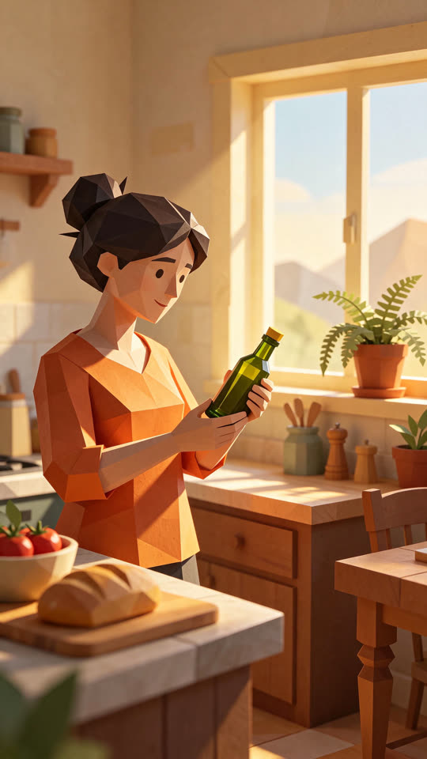

# Low Poly (3D and stop-motion)
<!-- generated from studio/styles/catalog/low-poly.json by studio/bin/catalog.mjs; edit the JSON -->

**Looks like:** angular faceted geometry with visible hard edges; each facet one flat colour, no texture maps; small harmonised palette; quiet diorama scale with simple shapes standing for detail.
**Best for:** calm explainers and how-it-works beats, outdoor and nature scenes, tech, games and travel stories, loops and isometric dioramas. **Products:** products with simple geometric shapes (bottles, boxes, devices); calm, clever, modern brands.

## STYLE block (paste verbatim into every shot prompt and every sheet prompt)
Low-poly 3D: every character, prop and set is built from a small number of flat triangular and four-sided facets with visible hard edges between them; flat faceted shading, each facet one solid colour, no smoothing and no texture maps; a limited palette of six to ten harmonised colours, with a soft gradient only in the sky; a clear directional sun and a coloured ambient fill, so the facets step cleanly from light to shade; simple shapes stand in for detail: a leaf is three triangles, a face is a few planes with dot eyes; a calm tabletop-diorama scale.

## Rendering
- Line: no outlines: the facet edges are the drawing
- Shading: flat per-facet shading from one sun and a tinted ambient; soft contact shadows only, no ambient-occlusion grime
- Colour: six to ten colours, analogous with one complementary accent; product colours exact
- Texture: none; surfaces are clean flat colour
- Lighting: one directional sun at about 45 degrees plus a coloured sky fill; long soft shadows at golden hour

## MOTION block
Deliberate, simple motion: rigid parts rotate on clear pivots, characters move in clean arcs with mild ease in and out; limbs stay faceted and never bend like skin; optionally stepped on twos for a crafted feel; the facet layout never subdivides, ripples or re-triangulates.

## CAMERA habits
Elevated three-quarter or near-isometric views on longer lenses (70-100 mm) that keep the geometry crisp; slow orbits around a diorama, gentle dolly-ins; one move per shot.

## Avoid (name these instances only when the shot is at risk)
- smooth subdivided surfaces appearing mid-shot
- photo textures mapped onto facets
- facets shimmering or re-triangulating between frames
- soft individual hair strands
- realistic wet eyes on faceted faces

## Element sheets for consistency
Character turnarounds (front, three-quarter, side) on a flat pale backdrop with the facet layout clearly visible and the palette swatches listed in the prompt; places as one elevated diorama view plus a closer angle; the product from a Blender low-poly render as the first reference, label reduced to colour blocks.

## Where Seedance goes wrong in this style
The facet count is the first thing Seedance loses: it smooths surfaces, adds detail and re-triangulates so the facets shimmer. Repeat 'rigid flat-shaded geometry, the facet layout stays fixed' in MOTION, keep moves slow and clips 4-6 s, and use Blender renders for the product and set. Fine label text cannot survive the style; show colour blocks and add the real label in the edit. Example test (Nov 2026): The Seedream example lost the facets (smooth shading): say "flat-shaded triangles, every facet one solid colour" in every prompt.

## Models
Sheets and places: `bytedance-seed/seedream-5-5` · video: `bytedance/seedance-2.5` (draft on Flash 480p, final on 2.5 720p with the same prompt, references and seed).

## Example still (our own generation)
Prompt: Low-poly 3D still: a faceted woman in her thirties, her face a few flat planes with dot eyes, a dark bun made of a handful of triangles and an orange top of angular facets, holds a small green glass bottle with a yellow cap in a sunny low-poly kitchen; a droopy fern of flat triangular leaves sags on the windowsill; flat per-facet shading from a warm sun through the window, tinted ambient fill, a palette of eight colours, no textures. Vertical 9:16. No text.

## Sources (look, don't copy)
- [Kling AI · Cartoon Styles for AI (Low Poly Style)](https://kling.ai/blog/cartoon-styles-for-ai)
