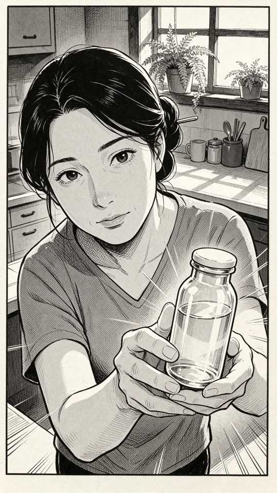

# Manga (Anime and manga)
<!-- generated from studio/styles/catalog/manga.json by studio/bin/catalog.mjs; edit the JSON -->

**Looks like:** black ink on white paper, no colour; dot and gradient screentones for midtones and shadows; panel-like framing with hard borders and dramatic crops; strong contrast with solid black fills and hatching.
**Best for:** dramatic or suspense hooks, a turn told in a few bold frames, young readers of comics, stories with a reveal. **Products:** products with a strong shape that read without colour (bottles, tools, gadgets, shoes); bold, dramatic or ironic brands.

## STYLE block (paste verbatim into every shot prompt and every sheet prompt)
Black-and-white Japanese manga page come to life: crisp black ink lines with pen pressure, thick contours and fine inner hatching; midtones and shadows are mechanical dot screentones and gradient tones, with solid black fills for hair and deep shadow; pure white paper highlights; strong contrast and graphic composition; frames feel like single manga panels with hard edges, dramatic crops and occasional focus lines radiating toward the subject; faint paper texture and print grain; no colour anywhere, no grey airbrush, no 3D.

## Rendering
- Line: G-pen style ink line with strong pressure variation; dense parallel and cross hatching for texture and shadow
- Shading: dot screentone and gradient tone patches with hard cut edges; solid black for deep shadows and hair
- Colour: none: pure black, white and screentone greys; the product reads by shape and tone only (or, as a deliberate choice, as the only spot colour in the frame)
- Texture: visible screentone dots, slight paper fibre, faint print misregistration
- Lighting: graphic: light shown by white paper and tone placement, strong backlight silhouettes for drama

## MOTION block
Mostly held panels with minimal motion, like a motion comic: one element moves at a time (hair, an eye, a hand, falling tone flecks), tones and focus lines pulse on beats; actions jump between strong poses on threes or fours; occasional fast push into a new panel crop.

## CAMERA habits
Panel grammar: extreme close-ups on eyes and hands, tilted dramatic angles, slow push-in on a still panel, a hard cut to a new panel framing; a slide from one panel to the next like reading a page; no smooth orbit.

## Avoid (name these instances only when the shot is at risk)
- any colour or sepia tint creeping in
- soft grey airbrush shading instead of screentone
- 3D rendered depth and lighting
- speech balloons and sound-effect lettering
- screentone dots crawling or boiling between frames

## Element sheets for consistency
Each character sheet is an inked black-and-white turnaround (front, three-quarter, side) with the exact screentone placement on hair and clothes noted, plus two expressions; the product is inked as a crisp prop with its silhouette and label area exact, tone placement fixed; places are inked background panels.

## Where Seedance goes wrong in this style
Video models dislike pure black-and-white and slowly add colour or soft grey shading, and screentones shimmer or crawl when the camera moves; keep the camera mostly locked and repeat 'black ink and screentone only, no colour'. The product loses its colour cue, so either rely on its silhouette or decide on a single spot-colour rule at the sheet stage and keep it in every shot. Seedance may add speech balloons or sound-effect lettering; forbid them in NO TEXT.

## Models
Sheets and places: `bytedance-seed/seedream-5-5` · video: `bytedance/seedance-2.5` (draft on Flash 480p, final on 2.5 720p with the same prompt, references and seed).

## Example still (our own generation)
Prompt: Black-and-white manga panel: a woman in her thirties with a dark bun drawn in solid black ink and a top shaded in mid-grey screentone (her orange top rendered as tone), holds a small glass bottle with a pale cap close to the camera, the glass shown with white highlights and gradient tone; behind her a sunny kitchen inked with fine hatching, white sunlight across the counter, and a droopy fern on the windowsill in drooping inked fronds; strong contrast, dot screentones, faint focus lines toward the bottle, paper grain. Vertical 9:16. No text.

## Sources (look, don't copy)
- [Kling AI · Cartoon Styles for AI (Manga Style)](https://kling.ai/blog/cartoon-styles-for-ai)
