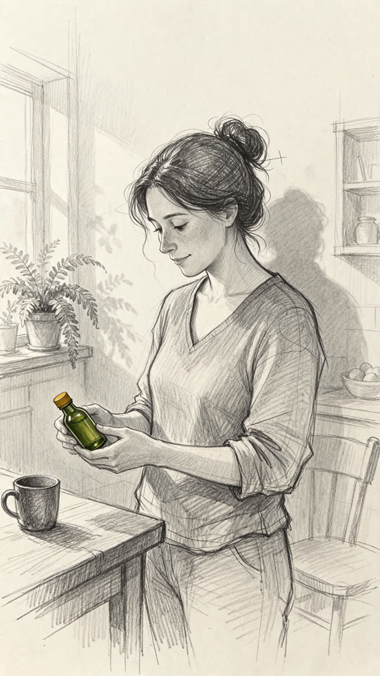

# Pencil Sketch (Handcrafted illustration)
<!-- generated from studio/styles/catalog/pencil-sketch.json by studio/bin/catalog.mjs; edit the JSON -->

**Looks like:** graphite strokes with visible pressure changes; rough cross-hatched and smudged shading; construction lines and searching marks left in; off-white sketchbook paper with eraser ghosts.
**Best for:** ideas taking shape and before/after reveals, craft, design and tool products, quiet, reflective moments, an ad that turns from sketch to colour at the reveal. **Products:** stationery, tools, furniture, architecture, design and maker products; thoughtful, crafted, honest brands.

## STYLE block (paste verbatim into every shot prompt and every sheet prompt)
Graphite pencil animation on off-white sketchbook paper: figures drawn with a soft 2B line that thickens with pressure and thins at the ends, with faint construction circles and searching double lines left in; shading in loose diagonal hatching and finger-smudged graphite, darkest in the core shadows; edges of the drawing trail off into bare paper instead of filling the frame; faint eraser ghosts of earlier poses; the whole picture is grey graphite, with colour used only on the product as a single coloured-pencil accent.

## Rendering
- Line: soft graphite line with pressure variation, doubled and searching at the joints, construction lines visible
- Shading: diagonal hatching in one direction, cross-hatching in deep shadow, smudged midtones
- Colour: monochrome warm grey graphite on off-white paper; one coloured-pencil accent reserved for the product (green bottle, yellow cap)
- Texture: paper tooth catching the graphite, smudges, eraser marks, a vignette where the drawing fades out
- Lighting: expressed only by hatching density; one clear light direction, the light side left as bare paper

## MOTION block
Animated on twos and threes with a visible line boil: every drawing is re-traced, so lines jitter slightly even on holds; hatching re-draws itself each frame instead of sliding; key poses hold while only the moving part is redrawn; the paper sheet stays fixed to the frame.

## CAMERA habits
Mostly locked, like a camera over a light table; slow push-ins; scene changes by the drawing building itself stroke by stroke or fading out to bare paper; no 3D orbits.

## Avoid (name these instances only when the shot is at risk)
- clean digital vector lines
- smooth photographic grey gradients
- hatching that slides across a moving form like a texture
- full colour leaking into the whole frame
- handwritten words or notes on the paper

## Element sheets for consistency
A pencil turnaround on the same paper (front, three-quarter, side) with construction lines visible and the hatching direction shown; the product is drawn in graphite with its coloured-pencil accent so the video knows which part carries colour.

## Where Seedance goes wrong in this style
Seedance either freezes the line (no boil, so it reads as a filter on 3D) or lets hatching slide over moving forms; ask for 're-drawn every frame, visible line boil, on twos' and keep motion slow. It also likes to add scribbled handwriting in margins and to spread the accent colour; say 'grey graphite only, colour only on the bottle'.

## Models
Sheets and places: `bytedance-seed/seedream-5-5` · video: `bytedance/seedance-2.5` (draft on Flash 480p, final on 2.5 720p with the same prompt, references and seed).

## Example still (our own generation)
Prompt: Graphite pencil sketch still on off-white sketchbook paper: a woman in her thirties with a dark bun and a top shaded as a mid-grey, drawn in a soft pressure-varied line with construction lines left in, holds a small glass bottle that is the only colour in the frame, coloured-pencil green with a yellow cap; a sunny kitchen sketched in loose hatching that fades into bare paper at the edges, a droopy fern on the windowsill in smudged graphite; eraser ghosts. Vertical 9:16. No text.

## Sources (look, don't copy)
- [Kling AI · Cartoon Styles for AI (Pencil Sketch Style)](https://kling.ai/blog/cartoon-styles-for-ai)
