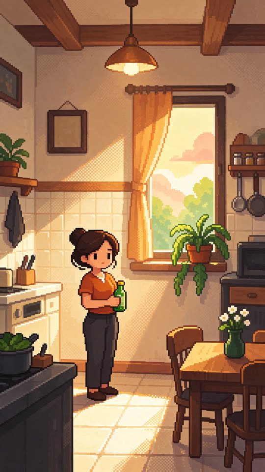

# Pixel Art (Digital and vector)
<!-- generated from studio/styles/catalog/pixel-art.json by studio/bin/catalog.mjs; edit the JSON -->

**Looks like:** visible square pixels on one fixed low-resolution grid; restrained 16-24 colour palette with dithering; compact sprites with large heads; tile-based rooms and snappy low-frame-count motion.
**Best for:** game-like quests and level-up stories, nostalgic, nerdy humour, apps, tech and games. **Products:** games, apps, gadgets and snacks; playful, nostalgic, tech-savvy brands.

## STYLE block (paste verbatim into every shot prompt and every sheet prompt)
Pixel art at a low native resolution, scaled up with hard nearest-neighbour edges: every form is made of visible square pixels on one fixed grid, about 180 pixels across the frame; a restrained palette of 16 to 24 colours, with ordered dithering for gradients and hue-shifted shadows that turn cooler and more saturated as they darken; hand-placed one-pixel outlines darker than the fill; characters are compact sprites with large heads; no anti-aliasing, no blur, no smooth gradients; sets are tile-based rooms with a clear floor line.

## Rendering
- Line: one-pixel hand-placed outlines a shade darker than the fill, lighter on lit edges
- Shading: two or three flat value steps per material, ordered dithering between them, hue-shifted shadows
- Colour: fixed 16-24 colour palette shared by the whole film; product colours mapped to the nearest palette entries
- Texture: the pixel grid itself; tiles repeat visibly on floors and walls
- Lighting: a consistent light side baked into the sprites; no dynamic light or glow

## MOTION block
Sprite animation with few drawings: 4-8 frame cycles held on threes or fours (about 6-8 drawings per second), everything moves in whole-pixel steps, idle bobs of one pixel; no sub-pixel smoothing, no tweening, no motion blur.

## CAMERA habits
Fixed side-on or three-quarter top-down view; the camera scrolls in whole-pixel steps or cuts between rooms; no zooms and no rotation, which break the grid.

## Avoid (name these instances only when the shot is at risk)
- the pixel grid melting or resampling during motion
- anti-aliased soft edges
- mixed pixel sizes in one frame
- smooth zooms and camera rotation
- pixel glyphs that read as fake text

## Element sheets for consistency
Each character as a sprite sheet: front, side and back idle frames plus a 4-frame walk, on a flat background, with the palette listed and the sprite height in pixels stated in the prompt; places as tile-based room screens; the product as a small sprite with its colours mapped to the palette.

## Where Seedance goes wrong in this style
The hardest style here for Seedance: a video model works in continuous space, so the grid melts, pixel sizes mix and motion slides smoothly between positions. Keep the camera locked, motion small and clips 3-5 s; then in post downsample each frame to the target grid (nearest-neighbour), re-quantise to the palette and step the timing to threes, which restores most of the look. For hero shots, consider animating the approved sprites in code instead. Example test (Nov 2026): The Seedream example came out as a smooth illustration, not on a pixel grid: for real pixel art, snap frames to the grid and palette afterwards or animate hero shots in code.

## Models
Sheets and places: `bytedance-seed/seedream-5-5` · video: `bytedance/seedance-2.5` (draft on Flash 480p, final on 2.5 720p with the same prompt, references and seed).

## Example still (our own generation)
Prompt: Pixel art still at a low native resolution with hard square pixels: a compact sprite of a woman in her thirties with a large head, a dark pixel bun and an orange top holds a tiny green glass bottle with a yellow cap, standing in a sunny tile-based kitchen with a clear floor line; a droopy pixel fern sags on the windowsill; a 20-colour palette, ordered dithering in the sunlight patch, hue-shifted shadows, one-pixel dark outlines, no anti-aliasing. Vertical 9:16. No text.

## Sources (look, don't copy)
- [Kling AI · Cartoon Styles for AI (Pixel Art Style)](https://kling.ai/blog/cartoon-styles-for-ai)
