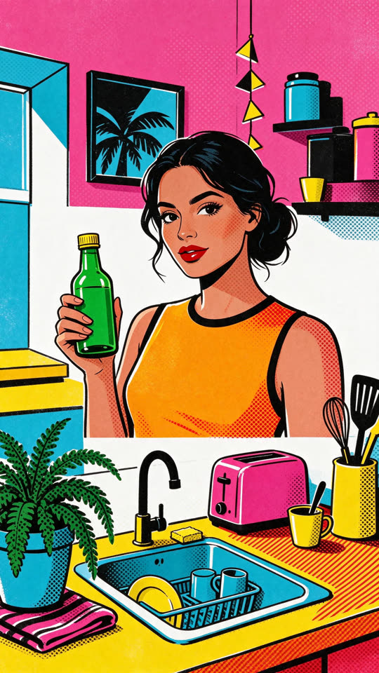

# Pop Art (Comic and graphic art)
<!-- generated from studio/styles/catalog/pop-art.json by studio/bin/catalog.mjs; edit the JSON -->

**Looks like:** flat saturated blocks of primary and fluorescent colour; enlarged halftone dots and line screens instead of shading; off-register silkscreen layers; repeated iconic forms.
**Best for:** product-as-icon reveals, fast, rhythmic hooks, bold launch and limited-edition ads. **Products:** packaged consumer goods with a strong shape and colour (drinks, snacks, cosmetics); loud, confident, fun brands.

## STYLE block (paste verbatim into every shot prompt and every sheet prompt)
Pop-art print look: flat saturated blocks of primary and fluorescent colour, red, yellow, cyan and hot pink, divided by thick black outlines; shading made only of enlarged halftone dots in one or two sizes and diagonal line screens, never smooth gradients; slightly off-register silkscreen layers, so colour slips a little past the line; flat graphic backgrounds of solid colour or repeating dots and stripes; faces simplified to a few bold shapes with glossy high-contrast lips and eyes; objects presented as bold isolated icons; the product is celebrated like an icon.

## Rendering
- Line: thick uniform black outlines, simplified contours
- Shading: halftone dots and diagonal line screens in flat tones; no gradients
- Colour: primary and fluorescent flat colours with hard contrasts, deliberate off-register; product colours exact as the anchor
- Texture: silkscreen ink and printed dot screens on smooth paper
- Lighting: no naturalistic lighting: light is expressed as a flat lighter block or a dot screen

## MOTION block
Graphic and rhythmic: snaps on the beat, short held poses on fours with sudden jumps, colour-swap loops where the same frame repeats in new palettes; very few in-betweens; the dot screen stays fixed and does not swim with the movement.

## CAMERA habits
Flat frontal compositions and centred close-ups; static frames and graphic zoom-punches; repetition grids are built in the edit.

## Avoid (name these instances only when the shot is at risk)
- halftone dots swimming or scaling during motion
- soft gradient shading replacing dot screens
- word bursts and onomatopoeia with fake text
- photographic skin on faces
- real packaging logos in a repeated grid

## Element sheets for consistency
Characters as a bold front and three-quarter portrait in the print style plus a flat colour-swatch strip; the product as a centred icon on a solid colour with its exact shape and colours; one palette-variant version of the product to test repetition grids.

## Where Seedance goes wrong in this style
Halftone texture is a screen pattern that Seedance redraws every frame, so dots crawl and buzz; keep motion small, clips 3-5 s, and write 'the dot screen is fixed and does not move'. It also adds word bursts; ban them in NO TEXT. Build repeated grids and colour swaps in the edit from one good clip.

## Models
Sheets and places: `bytedance-seed/seedream-5-5` · video: `bytedance/seedance-2.5` (draft on Flash 480p, final on 2.5 720p with the same prompt, references and seed).

## Example still (our own generation)
Prompt: Pop-art print still: a woman in her thirties with a dark bun and an orange top, simplified to bold shapes with thick black outlines and glossy high-contrast lips, holds a small green glass bottle with a yellow cap up like an icon, in a sunny kitchen of flat yellow and cyan blocks; a droopy fern on the windowsill is shaded with enlarged halftone dots; red diagonal line screens in the shadows, slightly off-register silkscreen colour, solid hot-pink wall. Vertical 9:16. No text.

## Sources (look, don't copy)
- [Kling AI · Cartoon Styles for AI (Pop Art Style)](https://kling.ai/blog/cartoon-styles-for-ai)
