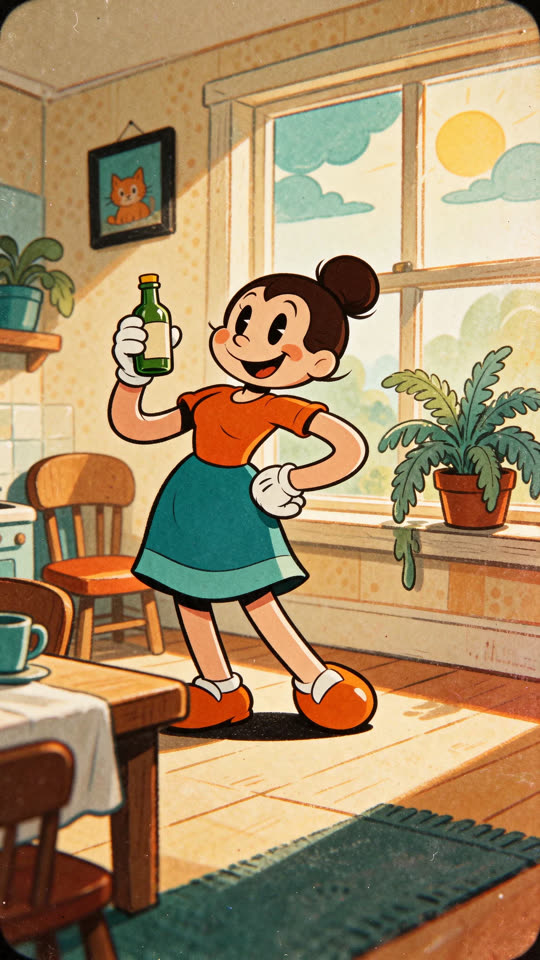

# Rubber Hose (Traditional 2D animation)
<!-- generated from studio/styles/catalog/rubber-hose.json by studio/bin/catalog.mjs; edit the JSON -->

**Looks like:** limbs drawn as boneless bendy tubes with no elbows or knees; circle-based heads with pie-cut eyes, white gloves and big round shoes; black-and-white or muted two-tone inking with film grain and flicker; springy, constantly bouncing motion even when standing still.
**Best for:** retro novelty hooks, jingle-style musical spots, household gadgets and pantry products, nostalgic or tongue-in-cheek brands. **Products:** coffee, sauces, soap, old-fashioned tins and bottles, anything with vintage packaging; playful, slightly cheeky brands.

## STYLE block (paste verbatim into every shot prompt and every sheet prompt)
1930s rubber hose cartoon: characters are built from circles with long boneless tube limbs that bend in smooth arcs, no elbows or knees; faces are simple with pie-cut black eyes, a wide grin, white four-finger gloves and big round shoes; solid black ink fills with thick even outlines; picture in soft monochrome greys or faded two-strip tones of muted red, teal and cream; flat backgrounds of simple stylised furniture with slightly wobbly perspective; projected film look with fine grain, slight gate weave, light flicker and soft vignetting at the corners.

## Rendering
- Line: thick, even black ink line with round ends; solid black masses for bodies, eyes and shoes
- Shading: almost none: flat fills, at most a grey drop shadow ellipse under each figure
- Colour: monochrome greys or a faded two-strip palette (muted red-orange, teal-green, cream); the product keeps its hue but is desaturated to sit in the palette
- Texture: film grain, dust specks, faint scratches, gentle flicker and vignetting
- Lighting: flat, evenly lit stage look; no cast lighting except simple shadows under feet

## MOTION block
Hand-drawn on ones and twos with a constant rhythmic bounce: characters bob on the beat even in idle, limbs swing like springs, objects and furniture also squash and dance; big anticipation and overshoot; cycles and repeated actions; no stillness longer than half a second.

## CAMERA habits
A locked camera framing a stage-like set head-on, full shots and medium shots, occasional iris-in or iris-out transitions; panning backgrounds that repeat; no perspective camera moves.

## Avoid (name these instances only when the shot is at risk)
- elbows, knees or realistic joints
- modern full-colour gradients and soft shading
- 3D depth and parallax camera orbits
- crisp digital clean frames with no grain
- lettering on the product or walls

## Element sheets for consistency
Each character sheet shows front, three-quarter and side in thick black ink on a cream background, with the hose limbs and glove shape clear, and a run of three bounce poses; the product is a simplified, slightly anthropomorphisable prop in the reduced palette with its exact silhouette and cap shape.

## Where Seedance goes wrong in this style
Seedance wants to give the limbs joints and to render a modern full-colour cartoon; say 'boneless tube limbs, no elbows' in STYLE and MOTION. The product's real colours fight the faded palette: decide at the sheet stage whether the product stays in colour against a grey world. Faces with pie-cut eyes can drift to regular pupils, so keep the sheet in every shot.

## Models
Sheets and places: `bytedance-seed/seedream-5-5` · video: `bytedance/seedance-2.5` (draft on Flash 480p, final on 2.5 720p with the same prompt, references and seed).

## Example still (our own generation)
Prompt: 1930s rubber hose cartoon still: a bouncy cartoon woman in her thirties with a dark bun and an orange top, long boneless tube arms, pie-cut eyes and white gloves, holds a small green glass bottle with a yellow cap; she stands in a simply drawn sunny kitchen with slightly wobbly perspective, beside a droopy fern on the windowsill whose fronds hang like limp noodles; thick black ink lines, faded two-strip colours of muted orange, teal and cream, film grain and soft vignette. Vertical 9:16. No text.

## Sources (look, don't copy)
- [Kling AI · Cartoon Styles for AI (Rubber Hose Style)](https://kling.ai/blog/cartoon-styles-for-ai)
