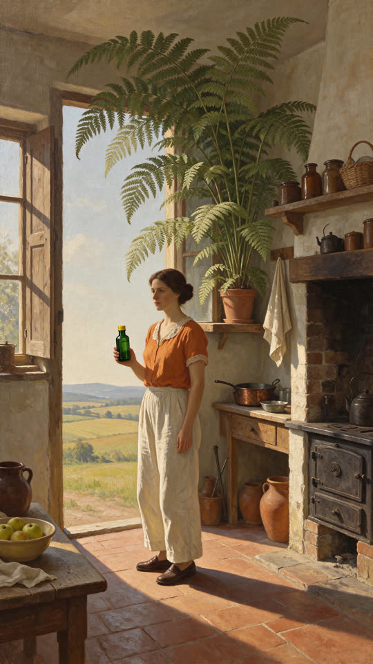

# Surreal (Experimental and mixed media)
<!-- generated from studio/styles/catalog/surreal.json by studio/bin/catalog.mjs; edit the JSON -->

**Looks like:** warped scale: giant everyday objects, tiny people; odd objects that behave impossibly but calmly; dreamlike spaces with long shadows and endless floors; clear, quiet light that makes the impossible believable.
**Best for:** a 'what if' hook that stops the scroll, the moment a product changes how the world feels, mood pieces with one striking image, fragrance, wellbeing and premium brands. **Products:** fragrance, drinks, wellbeing, plant and premium products; curious, poetic, confident brands.

## STYLE block (paste verbatim into every shot prompt and every sheet prompt)
Painted surrealist animation: an ordinary room rendered with calm, precise oil-painting realism, but its scale and logic are wrong in one clear way at a time, such as a fern taller than the doorway, a window that opens onto a sea, a floor that runs on to a far horizon; long hard shadows from a low late-afternoon sun; smooth matte paint with soft glazes and a fine canvas weave; a clear pale sky and a deep, empty perspective; everyone behaves as if nothing is strange; colours are clean and few, with the product as the brightest object.

## Rendering
- Line: no outlines; edges are crisp painted edges with slight softening into shadow
- Shading: smooth oil glazes with a clear single light direction and long cast shadows
- Colour: a restrained palette of clear sky blues, sand, terracotta and deep greens; the product the most saturated object in frame
- Texture: fine canvas weave and smooth glazed paint; no visible brush chaos
- Lighting: low, raking late-afternoon sun; long hard shadows; a luminous empty sky

## MOTION block
Slow, calm, real-time motion with long holds; impossible things happen smoothly and quietly (an object floats, a room stretches, a shadow points the wrong way) and then hold; one transformation per shot, never a chaotic morph; people move with grounded weight.

## CAMERA habits
Locked wide frames with deep perspective and a low horizon, or one very slow dolly that reveals the scale change; symmetrical compositions; no handheld, no fast cuts.

## Avoid (name these instances only when the shot is at risk)
- chaotic melting morphs of every object
- neon psychedelic colours
- horror distortions of faces or hands
- more than one impossible change at once
- lettering on objects or signs

## Element sheets for consistency
Characters in front, three-quarter and side in the calm painted realism, normal proportions; the place as a wide showing the scale rule (what is giant, what is tiny) and a detail view; the product in its exact shape and colours at normal scale and at the shot's warped scale.

## Where Seedance goes wrong in this style
Seedance treats 'surreal' as permission to morph everything, which turns faces and the product into melting shapes; name exactly one impossible thing per shot and say 'everything else stays solid and still'. The warped scale also drifts back to normal over a long clip, so state the scale in BLOCKING ('the fern's leaves reach the ceiling, twice her height') and keep clips short. Example test (Nov 2026): The Seedream example barely bent reality: name the one impossible thing per shot (e.g. "the fern is taller than the window") instead of the word "surreal".

## Models
Sheets and places: `bytedance-seed/seedream-5-5` · video: `bytedance/seedance-2.5` (draft on Flash 480p, final on 2.5 720p with the same prompt, references and seed).

## Example still (our own generation)
Prompt: Painted surrealist still in calm oil realism: a woman in her thirties with a dark bun and an orange top stands holding a small green glass bottle with a yellow cap in a sunny kitchen whose floor runs on to a far horizon; on the windowsill a droopy fern has grown so large its drooping leaves arch over her head and touch the ceiling; long hard late-afternoon shadows, a luminous pale sky through the window, fine canvas weave. Vertical 9:16. No text.

## Sources (look, don't copy)
- [Kling AI · Cartoon Styles for AI (Surreal Style)](https://kling.ai/blog/cartoon-styles-for-ai)
