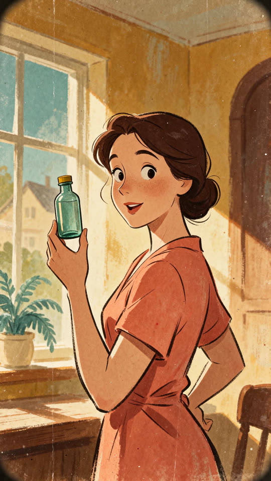

# Vintage Cartoon (Retro and nostalgic)
<!-- generated from studio/styles/catalog/vintage-cartoon.json by studio/bin/catalog.mjs; edit the JSON -->

**Looks like:** faded early colour or sepia-toned monochrome; aged film print marks: dust, scratches, flicker, gate weave; painted watercolour backgrounds behind flat inked figures.
**Best for:** playful, musical, slapstick stories, heritage or 'since long ago' brands, kitchen and household gags, short loops with a strong rhythm. **Products:** food, drink, cleaning, household and heritage products; cheerful, nostalgic, mischievous brands.

## STYLE block (paste verbatim into every shot prompt and every sheet prompt)
A mid-century theatrical cartoon print that has aged: characters with simple rounded forms, oval eyes with small pupils and expressive brows, inked in a confident black line with slight thick-thin variation and filled with flat gouache colour; the palette has faded and shifted on the print, warm reds turned salmon, greens toward teal, whites toward cream; backgrounds are soft painted plates with dry-brush texture behind the crisp inked figures; the whole image carries film age: fine grain, dust specks, a few vertical scratches, slight exposure flicker and a soft rounded vignette.

## Rendering
- Line: bold uniform black ink line, perfectly closed shapes, simple circles and curves; no line weight variation
- Shading: flat fills with almost no shadow; at most a simple drop shadow on the floor
- Colour: faded two-strip palette (salmon, teal, cream, black) or sepia monochrome; the product kept recognisable in a faded version of its colours
- Texture: film grain, dust, scratches, light leaks at the edges, exposure flicker, slight gate weave
- Lighting: flat and even, like a cel lit on a camera stand; vignette darkens the corners

## MOTION block
Animated on ones and twos with springy rubber-hose bounce: characters idle in a constant rhythmic bob, limbs swing in smooth arcs without elbows, strong squash and stretch on every step; objects come alive and dance to the beat; the print jitters slightly in the gate.

## CAMERA habits
Static stage-like framing, characters playing to the front as on a stage; trucking moves in and out on the flat background; iris-in and iris-out to open and close; no perspective-changing moves.

## Avoid (name these instances only when the shot is at risk)
- modern saturated digital colour
- clean sharp HD with no film wear
- realistic anatomy with elbows and knees
- 3D shading on the characters
- title cards or lettering burned into the print

## Element sheets for consistency
A model sheet in the period manner: front, three-quarter, side and two action poses in black line on a cream ground, with the head shape, eyes and costume fixed; then one coloured version in the faded palette; the product redrawn as a simple cartoon object in its faded colours.

## Where Seedance goes wrong in this style
Seedance keeps the film wear but drifts back to modern clean colour and realistic hands, and it may write fake title cards into the scratched print; repeat 'faded print palette, flat gouache fills, aged film' and 'no lettering'. Avoid iconic early-cartoon traits (pie-cut eyes with white gloves): they read as one specific old character and image models refuse them.

## Models
Sheets and places: `bytedance-seed/seedream-5-5` · video: `bytedance/seedance-2.5` (draft on Flash 480p, final on 2.5 720p with the same prompt, references and seed).

## Example still (our own generation)
Prompt: Aged mid-century cartoon still: a woman in her thirties with a dark bun, oval eyes and an orange top in faded salmon, drawn in a bold black ink line with flat gouache colour, holds up a small faded-green glass bottle with a yellow cap; a sunny kitchen painted as a soft dry-brush background plate, a droopy cartoon fern on the windowsill; faded print palette, film grain, dust and scratches, soft vignette. Vertical 9:16. No text.

## Sources (look, don't copy)
- [Kling AI · Cartoon Styles for AI (Vintage Cartoon Style)](https://kling.ai/blog/cartoon-styles-for-ai)
