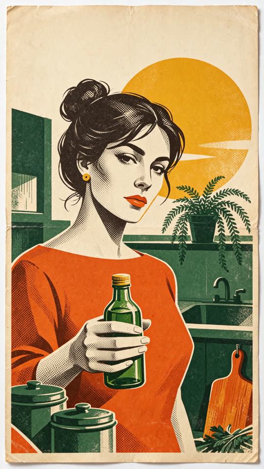

# Vintage Poster (Retro and nostalgic)
<!-- generated from studio/styles/catalog/vintage-poster.json by studio/bin/catalog.mjs; edit the JSON -->

**Looks like:** tight palettes of three to five flat inks; oversized, simplified shapes and bold silhouettes; worn print texture: misregistration, halftone, faded paper; strong graphic composition with one dominant subject.
**Best for:** hero product reveals and end cards, travel, place and seasonal stories, one bold image per shot, brands with a heritage or 'classic' feel. **Products:** drinks, travel, food, outdoor and heritage products; confident, classic, graphic brands.

## STYLE block (paste verbatim into every shot prompt and every sheet prompt)
A mid-century lithograph and screen-print poster brought to life: a tight palette of four flat inks plus the cream of the paper, each colour printed as one solid shape with no gradients; oversized simplified forms, a low horizon, a dominant subject filling the frame and a huge sun or window as a graphic disc; shadows printed as a single darker ink; slight misregistration so colours overlap or leave thin paper gaps; coarse halftone dots in the midtones, faded corners, folds and small scuffs on aged paper; the frame is an image only, with the poster's lettering area left empty.

## Rendering
- Line: no outlines; shapes meet edge to edge or with thin paper gaps from misregistration
- Shading: one darker ink for shadows, halftone dots for the few midtones; no soft rendering
- Colour: four flat inks (for example burnt orange, deep teal, mustard, dark green) plus cream paper; the product printed in its exact green and yellow
- Texture: aged paper, faded edges, folds, scuffs, misregistration, coarse halftone
- Lighting: graphic, not physical: a big sun disc or window shape and long flat shadow shapes

## MOTION block
Limited animation on threes: large flat shapes slide, rotate and scale as whole printed pieces; small cycles (steam, leaves, light rays) loop in two or three drawings; holds are long and composed like a poster; the paper texture and ink grain stay locked to the frame.

## CAMERA habits
Mostly locked, poster-like compositions; slow push-ins and vertical tilts that reveal the subject; parallax between two or three flat ink layers; no handheld or orbiting.

## Avoid (name these instances only when the shot is at risk)
- fake headline lettering and slogans
- smooth digital gradients in the sky
- photoreal shading on faces
- more than five colours in a frame
- paper texture sliding with the moving shapes

## Element sheets for consistency
Each character as a flat four-ink silhouette in front and profile with the ink palette swatches shown as plain colour blocks; the place as one full poster composition with an empty band where lettering would go; the product as a flat printed shape in its exact colours.

## Where Seedance goes wrong in this style
This is the style where Seedance most wants to write text: it fills the empty band with garbled headlines and adds labels to everything. Say 'no lettering anywhere, the top band is empty paper' in NO TEXT and STYLE, and add the real words in the edit. It also softens flat inks into gradients during camera moves; keep moves slow and repeat 'flat inks, no gradients'.

## Models
Sheets and places: `bytedance-seed/seedream-5-5` · video: `bytedance/seedance-2.5` (draft on Flash 480p, final on 2.5 720p with the same prompt, references and seed).

## Example still (our own generation)
Prompt: Mid-century screen-print poster still on aged cream paper: a woman in her thirties with a dark bun and an orange top as a bold flat silhouette holds a small green glass bottle with a yellow cap toward the viewer; a sunny kitchen simplified to oversized flat shapes, a huge window as a mustard disc, a droopy fern on the windowsill in dark green ink; four flat inks, slight misregistration, halftone midtones, faded scuffed edges, an empty paper band at the top. Vertical 9:16. No text.

## Sources (look, don't copy)
- [Kling AI · Cartoon Styles for AI (Vintage Poster Style)](https://kling.ai/blog/cartoon-styles-for-ai)
