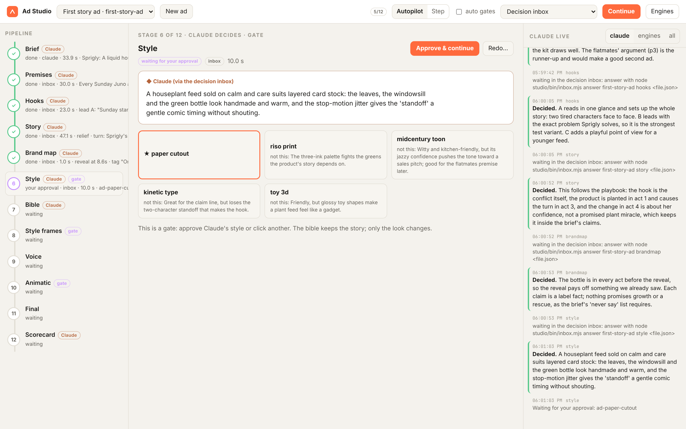
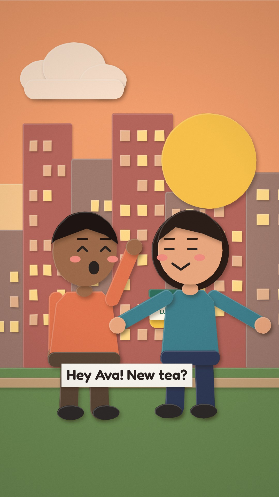
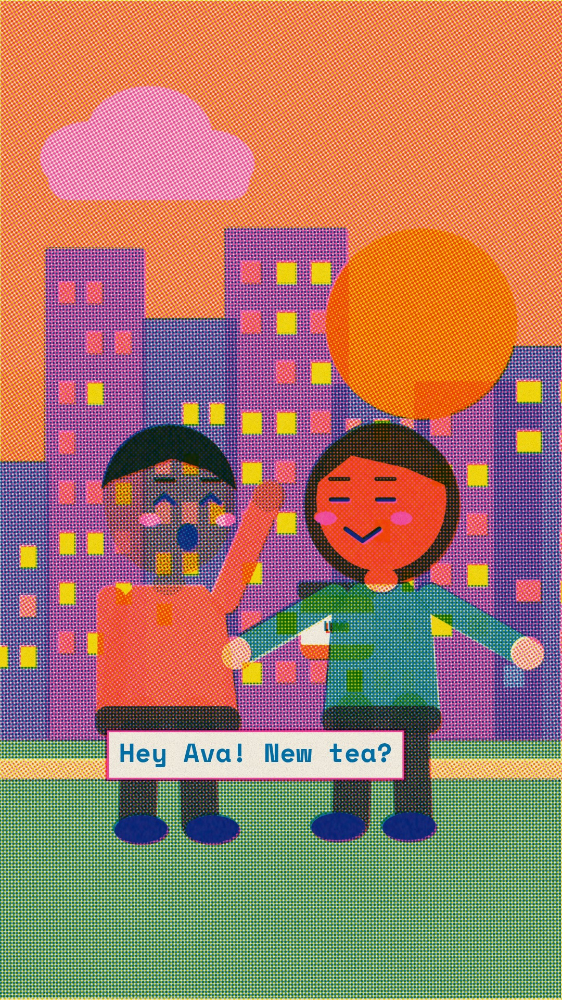
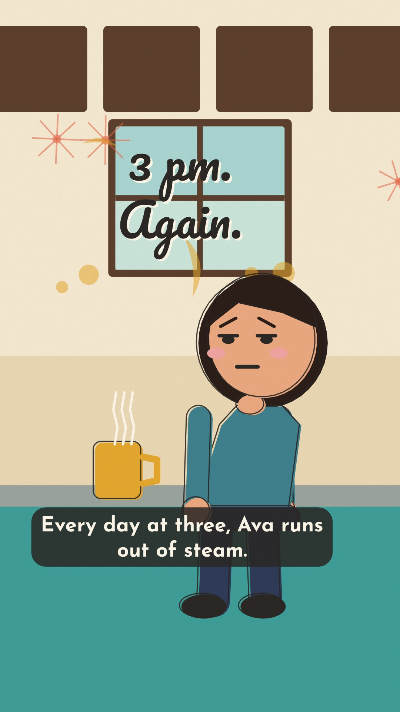
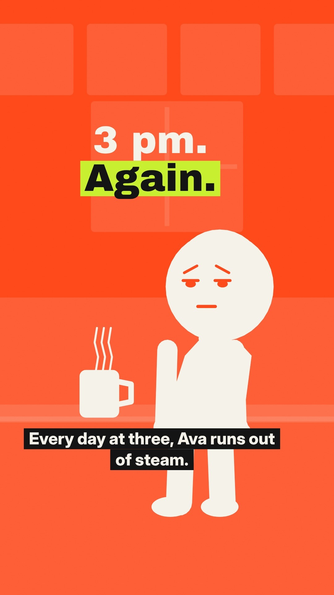
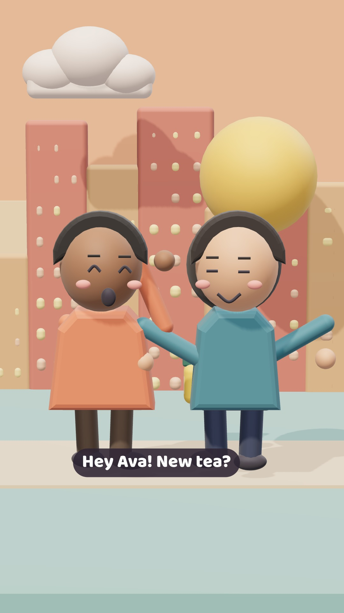

# Ad Studio

Ad Studio is a local app that turns a product into a finished **story ad** in an original, code-drawn style. There is no AI image or video generation anywhere in it. **Claude makes every decision**, and you watch the whole process live: the pipeline, Claude's reasoning, its tool calls, the frames, the voice, the checks and the finished files.



## What it does
Twelve stages. The first seven are mostly Claude's; the gates wait for you.

| # | Stage | Who | What comes out |
|---|---|---|---|
| 1 | Brief | Claude | product, honest proof, allowed claims (a fictional product if you want one) |
| 2 | Premises | Claude | ten situations → one, with the reason |
| 3 | Hooks | Claude | hooks A/B/C for the first 1–3 s; the lead plus two test variants |
| 4 | Story | Claude | Story Spine and five acts on the clock |
| 5 | Brand map | Claude + lint | plant, pulse, reveal, tag; every claim tied to a proof |
| 6 | Style | Claude, **gate** | one of the five styles below |
| 7 | Bible | Claude + checks | the whole ad as data: shots, layers, voice lines, end card, hook variants |
| 8 | Style frames | engines + Claude, **gate** | one frame per shot (9:16 and 16:9); Claude reviews them and fixes the bible |
| 9 | Voice | engines | VoiceStudio → Kokoro → ElevenLabs (free tier); speech check; captions and `.srt` |
| 10 | Animatic | engines, **gate** | a low-resolution cut with sound; reading-time and safe-zone checks |
| 11 | Final | engines | 1080×1920 and 1920×1080 masters at −14 LUFS, hook variants, poster |
| 12 | Scorecard | Claude | the playbook's seven rules scored 1–5; `out/REPORT.md` |

**The five styles** are all original and drawn in code from the same bible, so any story works in any of them. Each has its guide in `styles/<slug>/STYLE.md`.

| Paper Cut-out | Riso Print | Mid-century Toon | Kinetic Type | Toy 3D |
|---|---|---|---|---|
|  |  |  |  |  |

## Install on your Linux PC (with your local Claude Code session)
Tell your local Claude Code session:

> Install Ad Studio from `studio/` in this repo: run `bash studio/scripts/install_linux.sh`, start it, and open http://127.0.0.1:5170. Then make a new ad.

Or do it yourself:

```bash
bash studio/scripts/install_linux.sh
```

```bash
bash studio/scripts/start_studio.sh
```

Then open http://127.0.0.1:5170.

**Needs:** Node 20+, Python 3.11+, git and ffmpeg, plus the `claude` CLI logged in. The installer fetches the Lemo-Opuscar library, Kokoro, Whisper, and an ffmpeg 9 through imageio-ffmpeg.

**Optional:**
- `--voicestudio` installs VoiceStudio with its own installer from voicestudio.sh. It is third-party, so say yes knowingly. Ad Studio uses it first for voices.
- `--comfy` installs ComfyUI, used only to clean up a product photo you supply.

## Shot board: previz → Seedance 2.5 (the "let it cook" route)
Switch the header to **Shot board** after the bible is approved. Each shot goes through these steps, and every paid step shows its cost and waits for your OK:

1. **Element sheets** for characters, the product and places. These are the consistency anchors, made with an image model through OpenRouter.
   - The product sheet is far better with a free **Blender render of the product** as its reference (`production/blender/asset-product.json`).
   - You choose one sheet per element.
2. **Previz** of the shot: the code-drawn animatic without text or captions, or a **Blender** render of `production/blender/<shot>.json`.
3. **Motion mode:**
   - **styled keyframes** (works today): the image model repaints the previz's first and last frames in the final look with your sheets. You pick a first and a last, and Seedance animates between them.
   - **previz video:** the clip itself as the motion reference. OpenRouter accepts video references only as public HTTPS links, so set `media.publicBase` to a bucket you upload previz clips to.
   - **prompt only.**
4. **Takes:** Seedance 2.5 Flash 480p for drafts (about $0.07/s), Seedance 2.5 for finals. The prompt is built from the bible in the winners' block structure and you can edit it freely. Shots can chain, continuing from the previous shot's last frame. You pick a take.
5. **Finish shot** (free): ComfyUI `comfy/adstudio` workflow `finish_shot` colour-matches the take to the first approved keyframe and upscales it with Real-ESRGAN to 1920 tall. Without ComfyUI, an ffmpeg Lanczos upscale.

**Budget:** a hard cap (`budget.capUsd`, default $10). Every call is estimated first and logged in `studio/.ledger.jsonl`, and a call that would pass the cap is refused. `ADSTUDIO_MOCK=1` makes free placeholders for testing.

**Blender:** `studio/blender/adlib.py` builds a shot from JSON: products, toy characters, plants, primitives for mechanisms, 3D text, rooms or a cyclorama, real lenses and camera keys, light rigs, and five looks (clay, toy, clean, x-ray, blueprint). It runs as `blender -b --factory-startup -P studio/blender/run_shot.py -- shot.json out/`. For interactive fixes, use the Blender Lab MCP add-on (Blender 5.1+) with your local Claude session.

## Direction, memory and looks (round 11)
- **Direction stage (7):** a director's shot list (thesis, beats, shot sizes and moves with a reason for each shot, continuity locks) that the bible must implement. The kit camera frames shot sizes on a subject and keeps every frame on the drawn set. Method: the cinematic-director skill (DirectorSKILL, MIT).
- **Memory view:**
  - Claude's hindsight memory is lessons distilled from each ad's outcomes; the best ones go into every decision.
  - A lesson that shows up in 3 ads is proposed as a rule. Only your approval writes it into the skill.
  - To add an older ad: `node studio/bin/memory-backfill.mjs <slug>`.
- **Looks (Shot board):** 34 Seedance styles with prompt guides (`skills/seedance-styles/`). Picking one locks its style paragraph for every prompt.
  - Check the catalogue with `node studio/bin/catalog.mjs`.
  - Make our own example stills with `node studio/bin/catalog-examples.mjs --yes` (paid, about $0.02 each).
- **Style sheets:** `node studio/bin/stylesheet.mjs <style>` renders a bible in any kit style.

## Formats: 3D skit, 3D explainer, Recreate a video (round 12)
**New ad** now starts with a format.

- **Story ad.** The fourteen stages as before.
- **3D skit.** Voxel characters built from boxes talk it through on a dark stage with soft bokeh lights.
  - The style is fixed to `ad-voxel-3d` (three.js, free), so there is no style gate.
  - Dialogue alternates between the two speakers, each with their own Kokoro voice. A plant can talk too (`cast.<id>.kind: "plant"`).
  - Numbered steps appear in a top bar (`overlay.steps`). Captions come 1–3 words at a time, with one word in yellow (`captionMode: "words"`).
- **3D explainer.** One continuous camera moves through a world that is built layer by layer, with cutaways.
  - After the bible, the **3D world** stage asks Claude to write the scene as code: the `studio/blender/adlib.py` builders plus an optional script. It renders one still per beat, Claude reviews them (up to 2 fixes), then the whole move is rendered.
  - The render becomes the **plate** under the words, captions, voice and end card. In the cloud this is a CPU preview; on your PC, set `blender.engine` to `eevee` for GPU renders.
- **Recreate a video.**
  1. Upload an MP4 or MOV of up to 60 s, plus up to 12 reference images (characters, outfits, items, the product, places).
  2. Fill in what changes: the characters' look, what they wear, the items they have, the product, and any notes.
  3. Choose how to recreate it: **remake with our tools**, **motion transfer (Genjutsu)**, or **mixed, per shot**.
  - **Source stage (free, local):** finds the shot cuts, takes the first, middle and last still of each shot into contact sheets, and measures motion and camera moves. It also makes a word-timed transcript (faster-whisper) and measures loudness.
  - **Analysis stage (Claude):** fills in the shot table and maps each person, item and the product to what it becomes. The story stages then follow the original's beats, timing and shot sizes.
  - **Rights:** Genjutsu reuses the footage, so it needs your tick: "I own this video or have the rights to it". Without it, only the structure is remade.
- **Motion router.** Each shot gets a route. Claude can set it, or code decides from motion and complexity.
  - Free: `kit`, `three`, `blender`.
  - Paid: `seedance`, `genjutsu` (a segment of your upload), `blender→genjutsu` (our Blender motion, re-skinned photoreal).
  - In mixed mode, only shots where people move go to Genjutsu.
- **Genjutsu on the shot board.**
  - Consecutive Genjutsu shots merge into one 4–30 s span (15 s for Light). The span's take uses the source segment, up to 8 element picks (your uploads first) and a short prompt.
  - It shows the price and asks first: about $0.154/s at 480p, $0.34/s at 720p, $0.83/s at 1080p.
  - **Use picked clips in the edit** turns the chosen takes into plates. Then re-run Animatic and Final.
- **Higgsfield key:** add `HIGGSFIELD_KEY=<key id>:<key secret>` to `studio/.env`.
  - Spending has its own hard cap, `budget.higgsfieldCapUsd` (default $5), and its own ledger entries.
  - Set `higgsfield.mock: true` (or `ADSTUDIO_MOCK=1`) to test the flow for free with tinted placeholder clips.

## More than ads (round 13): explainers, short drama, an edit tool, a clipper
**New video** now offers 8 formats. The 4 new ones:

1. **Explainer.** Type a topic.
   - Claude writes a topic brief with **sourced facts**, then a question-led chain, in any kit style.
   - No product: the end card shows your channel and a CTA.
   - Free.
2. **Short drama.** Type a story idea, pick the episode count (1–20), the length (30–50 s) and a style, or describe your own.
   - Claude writes the series bible: the characters, the arc, and every episode's cliffhanger.
   - Each episode becomes its own video, with the cast, voices, places and palette locked by code.
   - Use **Run next** or **Run all** in the Episodes stage.
   - Each episode cuts on its most interesting moment, then shows a "Part N" tag.
3. **Edit a video.** Upload footage and 3–5 reference reels; Claude edits like the @viralex.aii workflow:
   1. the style is measured from the reels (`style.md`);
   2. pauses and slips are cut (never inside a word);
   3. word-by-word captions in the style (libass), a music bed ducked under the voice, a hook title, 9:16 at −14 LUFS.
   - You get `draft-v1`. Type notes in plain words for v2.
4. **Clip a stream.** Paste a Twitch, YouTube or Kick VOD, or upload a recording plus a chat log (TwitchDownloader, chat-downloader, YouTube live_chat, Kick, CSV).
   - **Streams:** the chat finds the moments (message rate, laughter, hype and "clip it" against a 3-min baseline). The chat delay is estimated from the audio. Each clip keeps about **10 s of build-up and 7 s of reaction** (measured on 14 viral clips).
   - **Normal videos:** OpenClip ranks the transcript (installed on your PC), or Claude ranks sentence windows.
   - Claude picks and trims with the clip rubric (`skills/clip-director`). Each clip renders 9:16 with a headline.
- **Install the clipper's tools** (OpenClip in `~/openclip`, plus chat-downloader):

  ```bash
  bash studio/scripts/install_openclip.sh
  ```

  OpenClip's LLM is OpenRouter (a cheap model, about cents per video), under your existing cap.
- **The viral playbook** (`skills/ad-studio-director/reference/viral-playbook.md`) comes from watching 45+ trending TikToks with the watch skill (`research/viral/`). Every Direction and Bible prompt reads the section for its format.

## Audience test: simulated viewers with MiroFish (stage 13, optional, paid)
After the final, **Run the audience test (≤ $1)** shows the finished ad, as text, to a swarm of simulated viewers in [MiroFish](https://github.com/666ghj/MiroFish). It then reads MiroFish's report back as a verdict card:
- scores for stop-scroll, watch-through, brand recall, trust and click intent;
- the opening that worked best;
- representative comments, fixes and risks.

The viewers are language-model agents, so treat the result as a smoke test for clarity and trust. It is not real audience data.

```bash
bash studio/scripts/install_mirofish.sh
```

```bash
bash studio/scripts/start_mirofish.sh
```

```bash
node studio/bin/audience.mjs <slug>
```

The first command installs MiroFish into `~/mirofish`, outside this repo. It is AGPL-3.0 and runs as its own service on :5001. The last command runs the test without the app.

- **No Zep account:** `integrations/mirofish/` swaps MiroFish's Zep Cloud graph for a local SQLite one. See its README.
- **Cheap viewers:** the simulated viewers run on DeepSeek v4.1 Flash through OpenRouter. Put your own key in `~/mirofish/.env`.
- **Token economy:**
  - The dossier (what a viewer sees and hears, second by second) is built by code.
  - Claude is called twice, each time in a one-off session with no tools, no skill prompt and low effort: about 3.5k context tokens instead of about 40k.
  - The setup is cached in `out/audience/setup.json`, so a retry costs no Claude call.
- **Cost guard:** spend is read from OpenRouter's key usage while the run goes. Past `mirofish.capUsd` ($1) the simulation is stopped, and every run is logged in the ledger.
- **Rounds:** 24 rounds is one simulated day. Viewers sleep from midnight to 05:00, so fewer than about 10 rounds simulate nobody; rounds where nobody is awake cost nothing.
- **Platforms:** Twitter and Reddit run together (`parallel`). That is MiroFish's default, and the only runner that reports when it has finished.

## How Claude is wired in
Each decision stage runs **Claude Code headless** in the ad's folder:

```
claude -p "<stage prompt>" --output-format stream-json --json-schema '<the stage schema>'
       --session-id/--resume <one session per ad> --append-system-prompt <skills/ad-studio-director/SKILL.md>
       --strict-mcp-config --permission-mode acceptEdits --allowedTools Read Write Edit Glob Grep "Bash(node:*)" "Bash(python3:*)"
```

- **One session per ad.** Claude keeps the context from stage to stage.
- **Live in the app.** The stream (text, tool calls, results) goes to the **Claude live** pane.
- **Checked answers.** Each answer is checked against the stage's JSON Schema, the claims lint (no absolutes, health claims, pressure or real brands) and the bible checks (shots tile the clock, voice fits, cast exists). A failed answer gets one repair turn.
- **Fallback: the decision inbox.** If the CLI isn't there or fails, the question waits in `ads/<slug>/decisions/pending/`. Any Claude session can answer it:

  ```bash
  node studio/bin/inbox.mjs list
  ```

  Then `node studio/bin/inbox.mjs show <slug> <stage>` and `node studio/bin/inbox.mjs answer <slug> <stage> answer.json`. The answer is schema-checked.
- **Cost.** Headless calls use your Claude Code login. The app shows Claude Code's own "list price" estimate per decision; on a subscription it is part of your plan. Choose the model and effort in `studio/config.local.json` (`claude.model`, `claude.effort`).

## Controls
- **Autopilot:** Claude decides and the run goes on, stopping only at the three gates.
- **Step:** every decision waits for **Looks good, continue**.
- **Auto gates:** also approves the gates. Use it for a quick full run.
- **Pick another:** click a different premise, hook or style. The app records that you overrode Claude, and the later stages become stale.
- **Redo…:** re-runs a stage with an optional note for Claude, e.g. "make the hook a question". The later stages become stale and run again.
- **Engines:** shows each engine's health, the fallback chains, and which keys are set.

## Engines and fallbacks (`config.json`, override in `config.local.json`)

| Need | Chain |
|---|---|
| decisions | `claude` (Claude Code CLI) → `inbox` |
| voice | `voicestudio` (http://127.0.0.1:3900, OpenAI-compatible `/v1/audio/speech`) → `kokoro` (CPU) → `elevenlabs` (off; free tier; `ELEVENLABS_API_KEY` in `studio/.env`) |
| speech check | `voicestudio` (`/v1/audio/transcriptions`) → `whisper` (faster-whisper) |
| product photo | `comfy` (upscale workflow on your ComfyUI) → `pillow` |
| picture | `lemo` (Lemo-Opuscar `core/render`, headless Chromium) |

Every fallback taken is recorded on its stage and shown with a ⤷ in the pipeline.

## Files

```
studio/
  server/      main.mjs (HTTP + SSE), pipeline.mjs (runner), stages.mjs (prompts, auto stages, report), schemas.mjs, lint.mjs, validate.mjs
  server/engines/  claude.mjs, inbox.mjs, render.mjs, voice.mjs, audio.mjs, comfy.mjs
  kit/         the ad page: page.js (bible → frames), shapes.js (people, products, props, places), styles/*.js, fonts/ (OFL)
  web/         the app (React + Motion + GSAP; built to web/dist)
  tools/       mix.py (synthesized score + foley + voice), safecheck.mjs
  bin/inbox.mjs, scripts/install_linux.sh, scripts/start_studio.sh, tests/
ads/<slug>/    project.json, brief.json, bible.json, decisions/, frames/, voice/, audio/, out/ (masters, .srt, poster, REPORT.md), log.jsonl
```

Everything an ad needs is in its folder. `log.jsonl` is the full event log, so the app can show you the whole run again later.

## Tests

```bash
cd studio && npm test
```

The tests cover the schemas, the lint, the bible checks, caption timing, voice casting, stale marking, overrides and the claude → inbox fallback.

## Credits and licences
- **Fonts** (all SIL OFL): Fredoka, Anton, Space Mono, Josefin Sans, Pacifico, Inter, Archivo Black and Baloo 2. The licence files are in `kit/fonts/`.
- **The interface** was built following the MIT-licensed design skills from freshtechbro/claudedesignskills (modern-web-design, motion-framer, gsap-scrolltrigger).
- **VoiceStudio** (AGPL-3.0) is called over its local API; no code from it is included.
- **cinematic-director** (DirectorSKILL by wuwangzhang1216, MIT) is fetched by `scripts/bootstrap.sh` into `~/.cache/ad-studio-skills/` and read by the Direction stage; it is not copied into this repo.
- **MiroFish** (AGPL-3.0) runs as a separate local service called over HTTP. The patch in `integrations/mirofish/` modifies it and is therefore AGPL-3.0; Ad Studio's own code doesn't include or import it.
- **Rendering** uses the Lemo-Opuscar library's tools.
